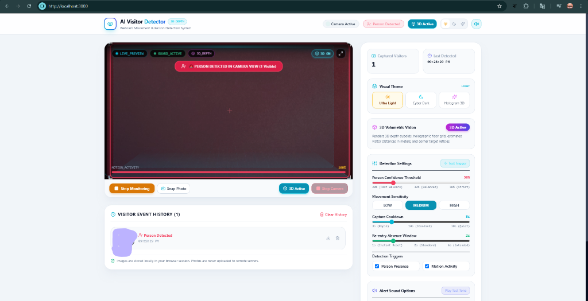
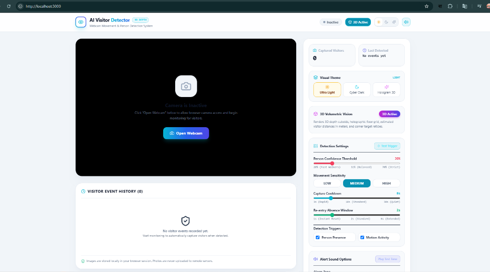

# 👁️ Home Visitor Detector

<p align="center">
  
  
  
  
  
  
  
  
</p>

<p align="center">
  <b>A lightweight, edge AI webcam security and visitor detection application with real-time person tracking, 3D volumetric cuboids, motion differencing, automatic photo snapshots, and synthesized audio alerts.</b>
</p>

---

## 📸 Interface Preview

<div align="center">
  <h3>✨ Ultra Light Theme • 3D Volumetric Vision Mode</h3>
  
  <br/><br/>
  <h3>🖥️ Standby & Monitoring Dashboard</h3>
  
</div>

---

## 🌟 Key Features

- 🧠 **Dedicated Full-Body Person Detection**: Powered by MediaPipe Tasks Vision (`EfficientDet-Lite0`). Detects human bodies across wide angles, profiles, fast lateral walking across the frame, partial occlusions, and edge entrances.
- 🧊 **3D Volumetric Vision Mode ("Convert 3D")**:
  - Renders **3D depth cuboids** around detected individuals with perspective depth connection rays and corner target reticles.
  - **Real-World Distance Estimation**: Dynamically calculates the estimated subject distance from the lens in meters (e.g. `1.8m`).
  - **Holographic Floor Grid & Laser Sweep**: Projects an isometric 3D matrix on the ground floor with animated scanning lasers.
- 🎯 **Dual Independent Detection Signals**:
  - **Person Detection (Primary)**: Fires immediately upon human presence, even if pixel motion change is minimal.
  - **Motion Differencing (Secondary)**: Real-time 160×120 grayscale frame comparison that triggers general activity events if non-human movement occurs.
- ⏱️ **Temporal Person Tracking (No Duplicate Spams)**:
  - Tracks individuals across frames using **IoU (Intersection-over-Union) + Centroid distance** matching.
  - Immediately captures **one photo** and sounds the alert when a visitor appears.
  - Keeps tracking them seamlessly without repeated spam captures while they stay in view.
  - **Configurable Absence Window**: Purges expired tracks after a set absence period (e.g. 2s) so re-entering visitors trigger fresh alerts.
- 🎨 **Multi-Theme Studio Support**:
  - ☀️ **Ultra Light**: Crisp, bright porcelain aesthetic with high-contrast slate borders.
  - 🌙 **Cyber Dark**: Deep obsidian slate (`#020617`) with electric cyan/blue neon accents.
  - ✨ **Hologram Neon 3D**: Futuristic cyberpunk purple HUD (`#070114`) with glowing fuchsia and emerald matrix elements.
- 🔊 **Built-in Web Audio Synthesizer**:
  - 4 customizable procedural alert tones: *Sonar Ping*, *Two-Tone Chime*, *Security Beep*, and *Cyber Pulse*.
  - Camera shutter audio feedback on capture.
  - Instant tone preview and volume slider.
- 📁 **Event History & High-Res Lightbox**:
  - Instant thumbnail stream with timestamps, sequence IDs, and event categorization.
  - Modal lightbox viewer with 1-click photo download (`.jpg`).
- 🔒 **100% In-Browser Privacy**:
  - Zero server uploads.
  - MediaPipe model weights and Wasm binaries run strictly inside the client's browser.
  - Captured images reside solely in local session memory.

---

## 🛠️ Tech Stack & Architecture

```
[ Webcam Feed (MediaDevices API) ]
                 │
                 ├──► [ Canvas Downsampler (160x120) ] ──► Frame Differencing (Motion Score)
                 │
                 └──► [ MediaPipe ObjectDetector ] ─────► Category: 'person' Detections
                                                                   │
                                                                   ▼
                                                       [ PersonTracker (IoU + Centroid) ]
                                                                   │
                                                                   ├──► New Visitor? ──► Auto Photo Capture
                                                                   │                   ──► Web Audio Synthesizer Alert
                                                                   │                   ──► Event History Log
                                                                   ▼
                                                       [ 3D Volumetric Projection Layer ]
                                                       • 3D Depth Cuboid & Rays
                                                       • Real-world Distance (m)
                                                       • Floor Matrix & Laser Scan
```

- **Framework**: [Next.js 14](https://nextjs.org/) (App Router)
- **Language**: [TypeScript](https://www.typescriptlang.org/)
- **Computer Vision**: [@mediapipe/tasks-vision](https://developers.google.com/mediapipe/solutions/vision/object_detector) (EfficientDet-Lite0 TFLite)
- **Styling**: [Tailwind CSS](https://tailwindcss.com/)
- **Icons**: [Lucide React](https://lucide.dev/)
- **Audio Engine**: Web Audio API Procedural Oscillator Synthesizer

---

## 🚀 Quick Start Guide

### Prerequisites
- [Node.js 18+](https://nodejs.org/) installed
- A modern desktop or mobile browser with camera support (Chrome, Edge, Firefox, Safari)

### 1. Clone the Repository
```bash
git clone https://github.com/xsazedul/Home-Visitor-Detector.git
cd Home-Visitor-Detector
```

### 2. Install Dependencies
```bash
npm install
```

### 3. Launch the Development Server
```bash
npm run dev
```

Open your browser and navigate to:
```
http://localhost:3000
```

---

## ⚙️ Configuration Reference

| Setting | Range / Options | Default | Description |
| :--- | :--- | :--- | :--- |
| **Visual Theme** | `Ultra Light` / `Cyber Dark` / `Hologram 3D` | `Ultra Light` | Global visual appearance and interface styling |
| **3D Mode** | `Enabled` / `Disabled` | `Enabled` | Toggles volumetric depth cuboids, depth rays, and floor matrix |
| **Person Confidence** | `20%` – `70%` | `30%` | Sensitivity threshold for full-body person detection |
| **Movement Sensitivity** | `Low` / `Medium` / `High` | `Medium` | Pixel delta threshold for general frame differencing |
| **Capture Cooldown** | `3s` – `30s` | `8s` | Minimum cooldown between consecutive visitor captures |
| **Absence Re-entry Window** | `1s` – `6s` | `2s` | Time a person must leave before re-entry triggers a new event |
| **Alarm Tone** | `Sonar Ping`, `Chime`, `Beep`, `Pulse` | `Sonar Ping` | Audio alert sound wave played upon visitor arrival |
| **Alert Volume** | `0%` – `100%` | `80%` | Master volume for procedural audio alerts |

---

## 🔒 Privacy & Security

1. **Permission Transparency**: The webcam is **never** initiated automatically on page load. Access requires an explicit click on **"Open Webcam"**.
2. **Local Inference**: Computer vision inference is executed on your device using WebAssembly and WebGL.
3. **No External Storage**: Snapshots are saved only in client browser memory and can be cleared instantly via **"Clear History"**.

---

## 📄 License

This project is open-source and released under the [MIT License](LICENSE).

---

<p align="center">
  Crafted with ❤️ for private, edge-powered AI computer vision.
</p>
